# BullMQ Event Bus in Microservices: Zero to Hero

## Table of Contents
1. [Foundational Concepts](#foundational-concepts)
2. [BullMQ Architecture](#bullmq-architecture)
3. [Event Bus Patterns](#event-bus-patterns)
4. [Implementation Guide](#implementation-guide)
5. [Advanced Patterns](#advanced-patterns)
6. [Production Considerations](#production-considerations)

---

## 1. Foundational Concepts

### What is an Event Bus?

An **event bus** is a sophisticated architectural pattern that facilitates asynchronous, decoupled communication between disparate microservices through event-driven messaging. It operates as a central conduit for propagating state changes, domain events, and system notifications across distributed system boundaries.

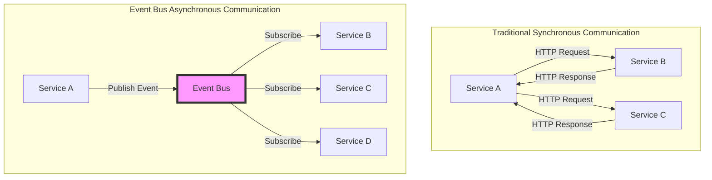

### Message Queue vs Event Bus

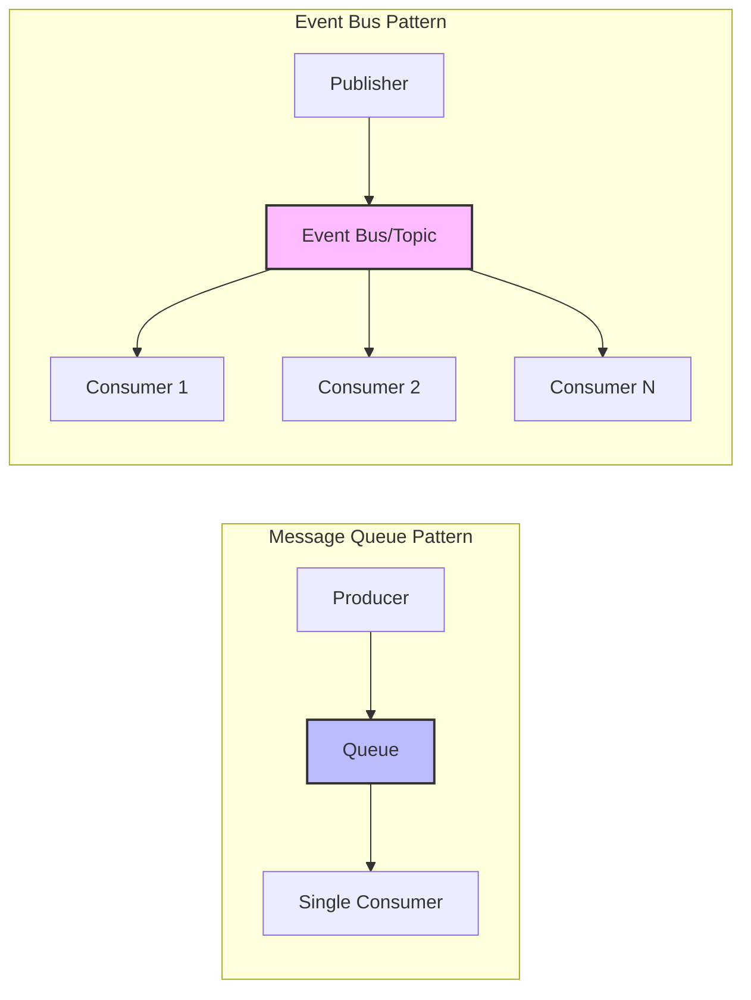

**Key Distinctions:**
- **Message Queue**: Point-to-point communication paradigm with singular consumption
- **Event Bus**: Publish-subscribe communication paradigm with multicasting capabilities

### Why BullMQ?

**BullMQ** is a premium Node.js library built atop Redis that provides:
- **Robust job/message queueing** with advanced persistence mechanisms
- **Distributed processing** capabilities across multiple worker nodes
- **Sophisticated retry logic** with exponential backoff strategies
- **Comprehensive event lifecycle management**
- **Rate limiting and concurrency controls**
- **Priority-based job scheduling**
- **Delayed job execution** with temporal precision

---

## 2. BullMQ Architecture

### Core Components

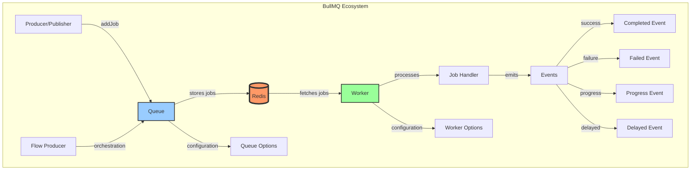

### Component Responsibilities

**1. Queue:**
- Ingests and persists jobs into Redis data structures
- Maintains job state machines (waiting, active, completed, failed, delayed)
- Provides job retrieval and management APIs

**2. Worker:**
- Continuously polls Redis for available jobs
- Executes job processing logic in isolation
- Manages concurrency, parallelism, and resource allocation
- Handles failure recovery and retry mechanisms

**3. Redis:**
- Serves as the centralized persistence layer
- Stores job metadata, payloads, and state transitions
- Enables distributed coordination via atomic operations
- Provides pub/sub for real-time event propagation

**4. Events:**
- Lifecycle notifications for job state transitions
- Observable streams for monitoring and debugging
- Integration points for cross-cutting concerns

---

## 3. Event Bus Patterns in Microservices

### Pattern 1: Simple Event Broadcasting

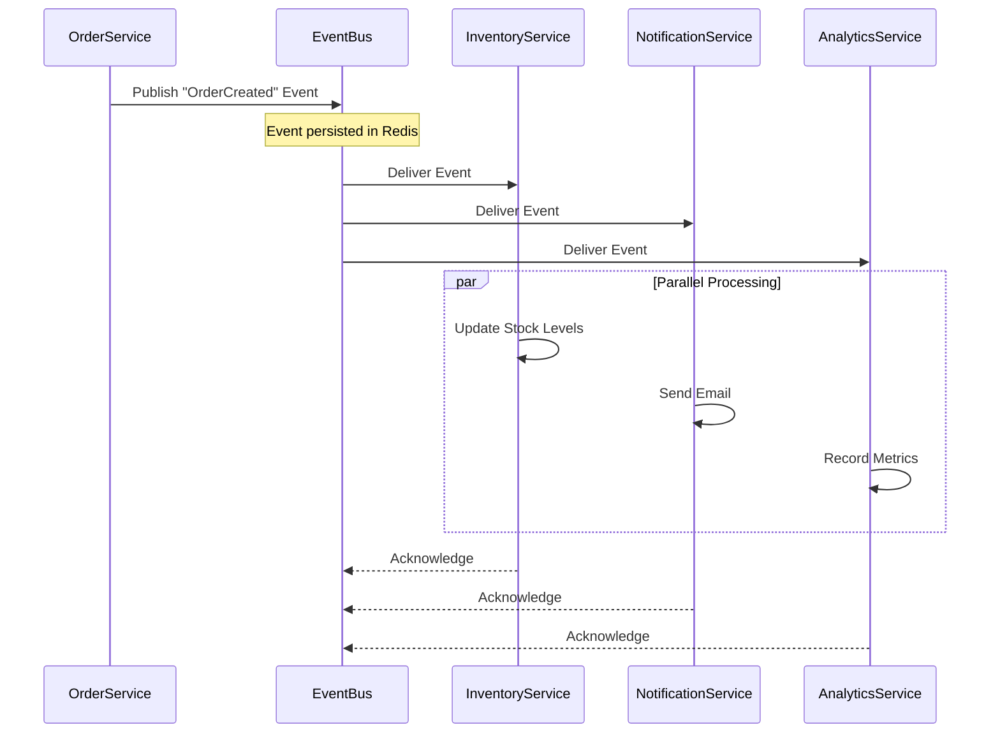

### Pattern 2: Event Choreography (Saga Pattern)

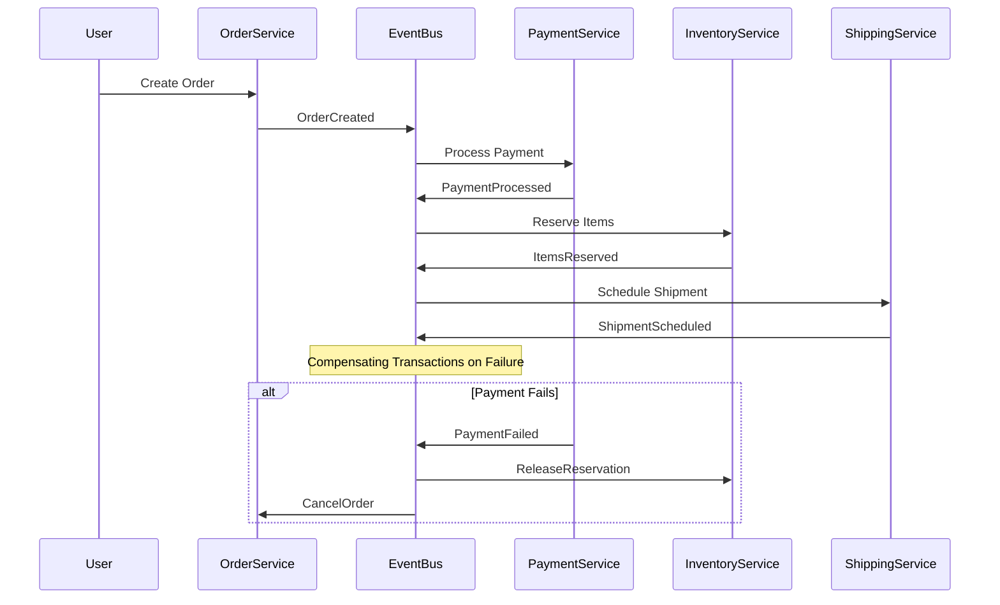

### Pattern 3: Event Sourcing Architecture

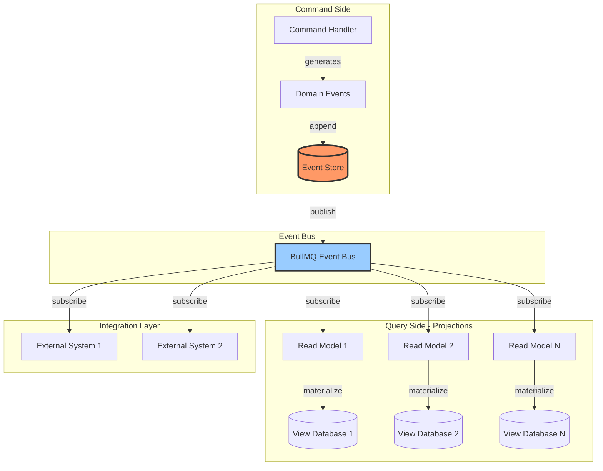

---

## 4. Implementation Guide

### Installation and Configuration

```bash
npm install bullmq ioredis
```

### Basic Queue Setup

```javascript
// redis-connection.js
const { Redis } = require('ioredis');

const redisConnection = new Redis({
  host: 'localhost',
  port: 6379,
  maxRetriesPerRequest: null,
  enableReadyCheck: false,
});

module.exports = redisConnection;
```

### Creating an Event Bus Abstraction

```javascript
// event-bus.js
const { Queue, Worker, QueueEvents } = require('bullmq');
const redisConnection = require('./redis-connection');

class EventBus {
  constructor() {
    this.queues = new Map();
    this.workers = new Map();
    this.queueEvents = new Map();
  }

  /**
   * Publishes an event to a specific topic/queue
   * @param {string} eventType - The event type/topic name
   * @param {object} payload - The event payload data
   * @param {object} options - Job options (delay, priority, etc.)
   */
  async publish(eventType, payload, options = {}) {
    let queue = this.queues.get(eventType);
    
    if (!queue) {
      queue = new Queue(eventType, {
        connection: redisConnection,
        defaultJobOptions: {
          attempts: 3,
          backoff: {
            type: 'exponential',
            delay: 1000,
          },
          removeOnComplete: {
            age: 3600, // Keep completed jobs for 1 hour
            count: 1000, // Keep last 1000 completed jobs
          },
          removeOnFail: {
            age: 86400, // Keep failed jobs for 24 hours
          },
        },
      });
      
      this.queues.set(eventType, queue);
    }

    const job = await queue.add(eventType, payload, {
      ...options,
      timestamp: Date.now(),
      eventId: `${eventType}-${Date.now()}-${Math.random()}`,
    });

    return job;
  }

  /**
   * Subscribes to events of a specific type
   * @param {string} eventType - The event type to subscribe to
   * @param {function} handler - The handler function to process events
   * @param {object} workerOptions - Worker configuration options
   */
  subscribe(eventType, handler, workerOptions = {}) {
    if (this.workers.has(eventType)) {
      console.warn(`Worker already exists for event type: ${eventType}`);
      return;
    }

    const worker = new Worker(
      eventType,
      async (job) => {
        try {
          console.log(`Processing event: ${eventType}`, job.data);
          await handler(job.data, job);
          return { status: 'completed', timestamp: Date.now() };
        } catch (error) {
          console.error(`Error processing event ${eventType}:`, error);
          throw error;
        }
      },
      {
        connection: redisConnection,
        concurrency: workerOptions.concurrency || 5,
        limiter: workerOptions.limiter,
        ...workerOptions,
      }
    );

    // Event listeners for monitoring
    worker.on('completed', (job) => {
      console.log(`✓ Event processed successfully: ${job.id}`);
    });

    worker.on('failed', (job, err) => {
      console.error(`✗ Event processing failed: ${job.id}`, err.message);
    });

    worker.on('error', (err) => {
      console.error(`Worker error for ${eventType}:`, err);
    });

    this.workers.set(eventType, worker);

    // Setup QueueEvents for additional monitoring
    const queueEvents = new QueueEvents(eventType, {
      connection: redisConnection,
    });

    this.queueEvents.set(eventType, queueEvents);

    return worker;
  }

  /**
   * Gracefully closes all queues and workers
   */
  async close() {
    const closePromises = [];

    this.workers.forEach((worker) => {
      closePromises.push(worker.close());
    });

    this.queueEvents.forEach((qe) => {
      closePromises.push(qe.close());
    });

    this.queues.forEach((queue) => {
      closePromises.push(queue.close());
    });

    await Promise.all(closePromises);
    await redisConnection.quit();
  }
}

module.exports = new EventBus();
```

### Microservice Implementation Examples

#### Order Service (Publisher)

```javascript
// services/order-service.js
const eventBus = require('../event-bus');

class OrderService {
  async createOrder(orderData) {
    // Business logic: Create order in database
    const order = await this.saveOrderToDatabase(orderData);

    // Publish domain event
    await eventBus.publish('order.created', {
      orderId: order.id,
      customerId: order.customerId,
      items: order.items,
      totalAmount: order.totalAmount,
      timestamp: new Date().toISOString(),
    });

    return order;
  }

  async saveOrderToDatabase(orderData) {
    // Database persistence logic
    return {
      id: 'ORD-12345',
      ...orderData,
      status: 'PENDING',
      createdAt: new Date(),
    };
  }
}

module.exports = new OrderService();
```

#### Inventory Service (Subscriber)

```javascript
// services/inventory-service.js
const eventBus = require('../event-bus');

class InventoryService {
  constructor() {
    this.setupEventHandlers();
  }

  setupEventHandlers() {
    // Subscribe to order created events
    eventBus.subscribe('order.created', async (eventData) => {
      await this.handleOrderCreated(eventData);
    }, {
      concurrency: 10, // Process 10 events concurrently
    });
  }

  async handleOrderCreated(orderData) {
    console.log('Inventory: Processing order', orderData.orderId);

    // Business logic: Reserve inventory
    for (const item of orderData.items) {
      await this.reserveInventory(item.productId, item.quantity);
    }

    // Publish subsequent event
    await eventBus.publish('inventory.reserved', {
      orderId: orderData.orderId,
      items: orderData.items,
      reservationId: `RES-${Date.now()}`,
    });
  }

  async reserveInventory(productId, quantity) {
    // Implementation details
    console.log(`Reserved ${quantity} units of product ${productId}`);
  }
}

module.exports = new InventoryService();
```

#### Notification Service (Subscriber)

```javascript
// services/notification-service.js
const eventBus = require('../event-bus');

class NotificationService {
  constructor() {
    this.setupEventHandlers();
  }

  setupEventHandlers() {
    eventBus.subscribe('order.created', async (eventData) => {
      await this.sendOrderConfirmation(eventData);
    });

    eventBus.subscribe('inventory.reserved', async (eventData) => {
      await this.sendInventoryNotification(eventData);
    });
  }

  async sendOrderConfirmation(orderData) {
    console.log('Notification: Sending order confirmation email');
    // Email sending logic
    await this.sendEmail({
      to: orderData.customerId,
      subject: 'Order Confirmation',
      template: 'order-confirmation',
      data: orderData,
    });
  }

  async sendInventoryNotification(eventData) {
    console.log('Notification: Inventory reserved notification');
    // Additional notification logic
  }

  async sendEmail(emailData) {
    // Email service integration
    console.log('Email sent:', emailData);
  }
}

module.exports = new NotificationService();
```

### Complete System Architecture

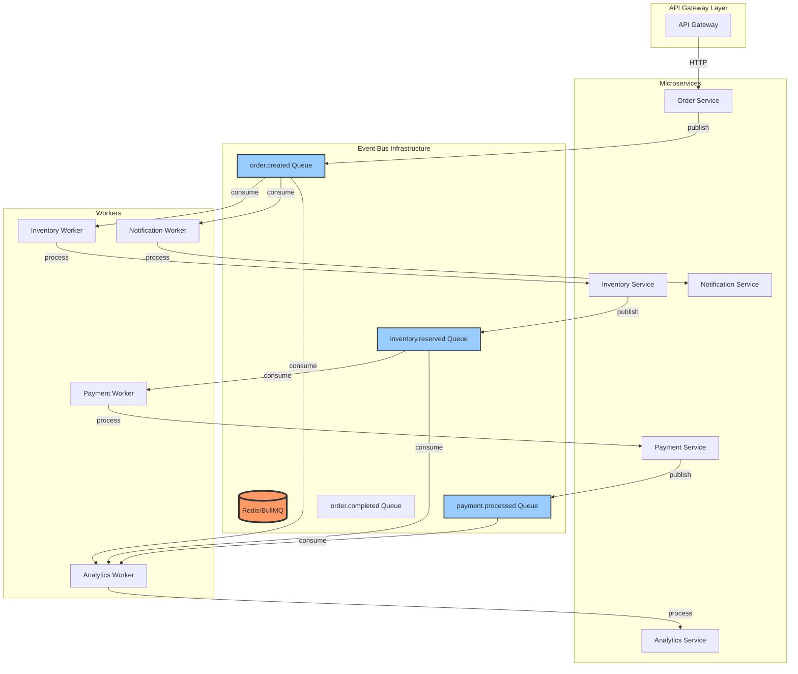

---

## 5. Advanced Patterns

### Pattern 1: Priority-Based Event Processing

```javascript
// Priority levels: 1 (highest) to 10 (lowest)
await eventBus.publish('order.created', orderData, {
  priority: 1, // Critical orders
});

await eventBus.publish('analytics.track', analyticsData, {
  priority: 10, // Low priority background tasks
});
```

### Pattern 2: Delayed Event Processing

```javascript
// Schedule event for future processing
await eventBus.publish('subscription.renewal', {
  subscriptionId: 'SUB-123',
  userId: 'USER-456',
}, {
  delay: 30 * 24 * 60 * 60 * 1000, // 30 days in milliseconds
});
```

### Pattern 3: Rate-Limited Processing

```javascript
eventBus.subscribe('email.send', emailHandler, {
  concurrency: 5,
  limiter: {
    max: 100, // Maximum 100 jobs
    duration: 60000, // Per 60 seconds
  },
});
```

### Pattern 4: Event Replay and Reprocessing

```javascript
const { Queue } = require('bullmq');
const redisConnection = require('./redis-connection');

async function replayFailedEvents(eventType, fromTimestamp) {
  const queue = new Queue(eventType, { connection: redisConnection });
  
  // Get failed jobs
  const failedJobs = await queue.getFailed();
  
  for (const job of failedJobs) {
    if (job.timestamp >= fromTimestamp) {
      // Retry the job
      await job.retry();
      console.log(`Retrying job: ${job.id}`);
    }
  }
}
```

### Pattern 5: Event Versioning

```javascript
// Publisher with versioned events
await eventBus.publish('order.created', {
  _version: '2.0.0',
  _schema: 'order-created-v2',
  orderId: 'ORD-123',
  // Version 2 specific fields
  deliveryPreferences: {
    window: '9AM-5PM',
    instructions: 'Leave at door',
  },
});

// Subscriber with version handling
eventBus.subscribe('order.created', async (eventData) => {
  const version = eventData._version;
  
  switch (version) {
    case '1.0.0':
      await handleOrderCreatedV1(eventData);
      break;
    case '2.0.0':
      await handleOrderCreatedV2(eventData);
      break;
    default:
      console.warn(`Unknown event version: ${version}`);
  }
});
```

### Pattern 6: Parent-Child Job Flows

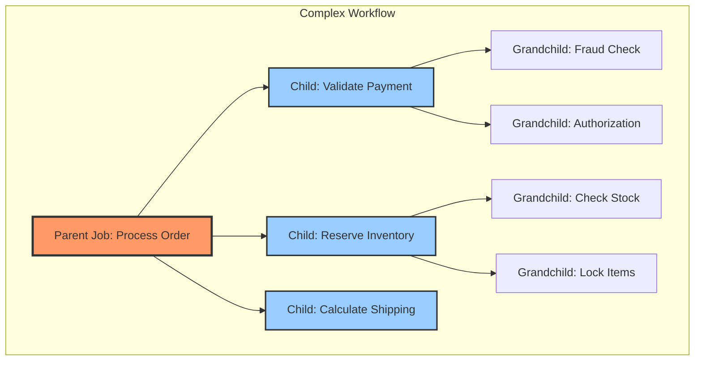

```javascript
const { FlowProducer } = require('bullmq');

const flowProducer = new FlowProducer({ connection: redisConnection });

const flow = await flowProducer.add({
  name: 'process-order',
  queueName: 'orders',
  data: { orderId: 'ORD-123' },
  children: [
    {
      name: 'validate-payment',
      queueName: 'payments',
      data: { orderId: 'ORD-123' },
      children: [
        {
          name: 'fraud-check',
          queueName: 'fraud-detection',
          data: { orderId: 'ORD-123' },
        },
        {
          name: 'authorization',
          queueName: 'payment-gateway',
          data: { orderId: 'ORD-123' },
        },
      ],
    },
    {
      name: 'reserve-inventory',
      queueName: 'inventory',
      data: { orderId: 'ORD-123' },
    },
  ],
});
```

---

## 6. Production Considerations

### Monitoring and Observability

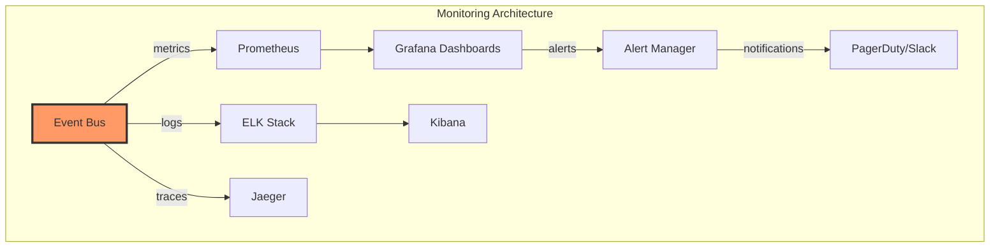

### Key Metrics to Monitor

```javascript
const { Queue } = require('bullmq');

async function collectQueueMetrics(queueName) {
  const queue = new Queue(queueName, { connection: redisConnection });
  
  const metrics = {
    waiting: await queue.getWaitingCount(),
    active: await queue.getActiveCount(),
    completed: await queue.getCompletedCount(),
    failed: await queue.getFailedCount(),
    delayed: await queue.getDelayedCount(),
    paused: await queue.isPaused(),
  };
  
  return metrics;
}
```

### Error Handling Strategies

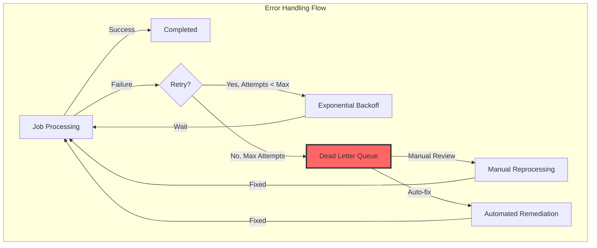

```javascript
eventBus.subscribe('critical.operation', criticalHandler, {
  concurrency: 5,
  attempts: 5,
  backoff: {
    type: 'exponential',
    delay: 2000,
  },
});

// Dead Letter Queue handler
eventBus.subscribe('critical.operation', async (eventData, job) => {
  if (job.attemptsMade >= 5) {
    // Move to DLQ
    await eventBus.publish('dead-letter-queue', {
      originalEvent: 'critical.operation',
      data: eventData,
      error: job.failedReason,
      attempts: job.attemptsMade,
    });
  }
});
```

### Scaling Strategies

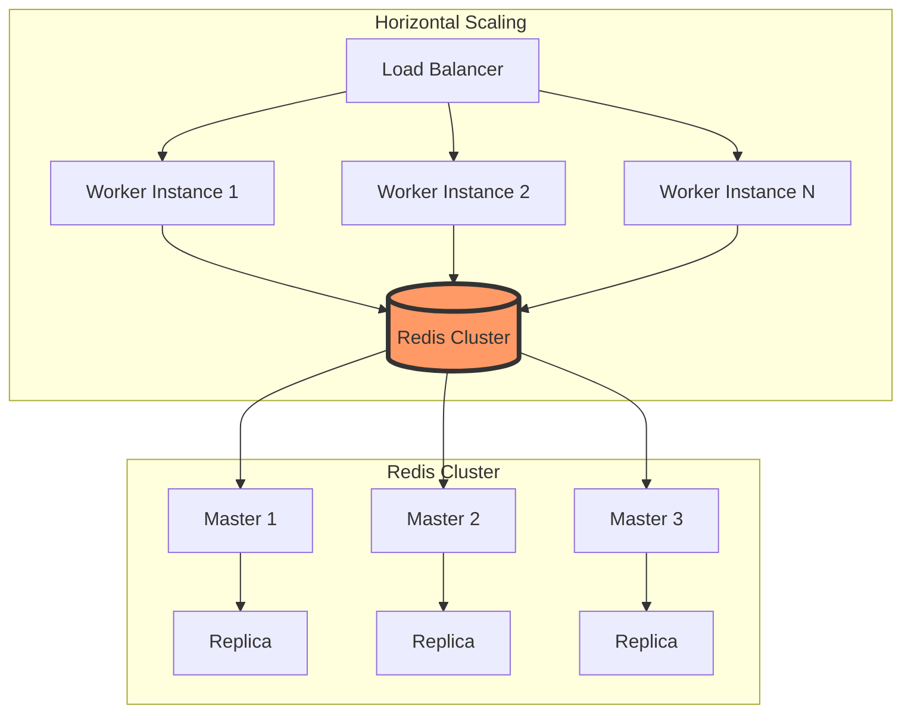

### Security Considerations

1. **Authentication & Authorization**
```javascript
const eventBus = require('../event-bus');

function publishSecureEvent(userId, eventType, payload) {
  // Add security context
  return eventBus.publish(eventType, {
    ...payload,
    _metadata: {
      userId,
      timestamp: Date.now(),
      signature: generateHMAC(payload),
    },
  });
}

function validateEventSignature(eventData) {
  const { _metadata, ...payload } = eventData;
  const expectedSignature = generateHMAC(payload);
  
  if (_metadata.signature !== expectedSignature) {
    throw new Error('Invalid event signature');
  }
}
```

2. **Encryption**
```javascript
const crypto = require('crypto');

function encryptSensitiveData(data, encryptionKey) {
  const cipher = crypto.createCipher('aes-256-gcm', encryptionKey);
  let encrypted = cipher.update(JSON.stringify(data), 'utf8', 'hex');
  encrypted += cipher.final('hex');
  return encrypted;
}

await eventBus.publish('payment.processed', {
  orderId: 'ORD-123',
  encryptedPaymentDetails: encryptSensitiveData(paymentDetails, KEY),
});
```

### Performance Optimization

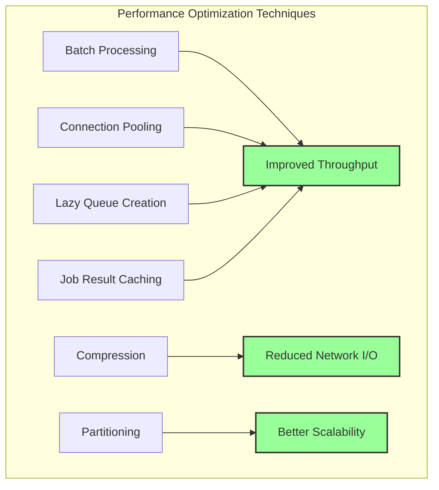

### Circuit Breaker Pattern

```javascript
class CircuitBreaker {
  constructor(threshold = 5, timeout = 60000) {
    this.failureCount = 0;
    this.threshold = threshold;
    this.timeout = timeout;
    this.state = 'CLOSED'; // CLOSED, OPEN, HALF_OPEN
    this.nextAttempt = Date.now();
  }

  async execute(fn) {
    if (this.state === 'OPEN') {
      if (Date.now() < this.nextAttempt) {
        throw new Error('Circuit breaker is OPEN');
      }
      this.state = 'HALF_OPEN';
    }

    try {
      const result = await fn();
      this.onSuccess();
      return result;
    } catch (error) {
      this.onFailure();
      throw error;
    }
  }

  onSuccess() {
    this.failureCount = 0;
    this.state = 'CLOSED';
  }

  onFailure() {
    this.failureCount++;
    if (this.failureCount >= this.threshold) {
      this.state = 'OPEN';
      this.nextAttempt = Date.now() + this.timeout;
    }
  }
}

// Usage with event processing
const breaker = new CircuitBreaker();

eventBus.subscribe('external.api.call', async (eventData) => {
  await breaker.execute(async () => {
    return await callExternalAPI(eventData);
  });
});
```

---

## Summary: BullMQ Event Bus Best Practices

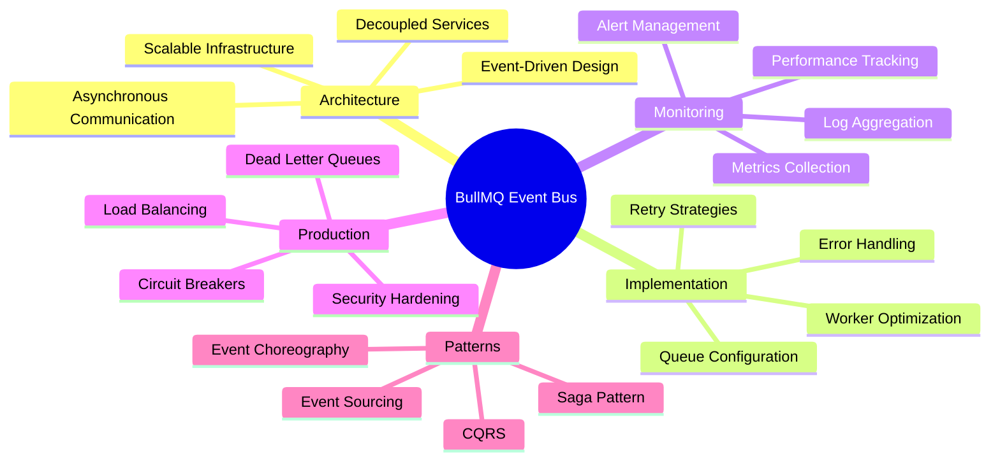

### Key Takeaways

1. **Architectural Decoupling**: BullMQ facilitates loose coupling between microservices through asynchronous event propagation
2. **Reliability**: Built-in retry mechanisms, persistence, and acknowledgment patterns ensure message delivery guarantees
3. **Scalability**: Horizontal scaling through multiple workers and Redis clustering enables high-throughput systems
4. **Observability**: Comprehensive event lifecycle hooks enable sophisticated monitoring and debugging capabilities
5. **Flexibility**: Support for various patterns (pub/sub, job flows, delayed processing) accommodates diverse use cases

### Production Checklist

- [ ] Configure Redis persistence (AOF + RDB)
- [ ] Implement comprehensive error handling
- [ ] Set up monitoring and alerting
- [ ] Design dead letter queue strategy
- [ ] Implement circuit breakers for external dependencies
- [ ] Configure appropriate worker concurrency
- [ ] Enable job result expiration
- [ ] Implement event versioning strategy
- [ ] Set up distributed tracing
- [ ] Configure rate limiting for protection
- [ ] Implement security measures (encryption, authentication)
- [ ] Design disaster recovery procedures
- [ ] Load test your event bus infrastructure

---

## Additional Resources

- **BullMQ Documentation**: https://docs.bullmq.io
- **Redis Documentation**: https://redis.io/docs
- **Microservices Patterns**: https://microservices.io/patterns
- **Event-Driven Architecture**: Martin Fowler's Enterprise Integration Patterns

